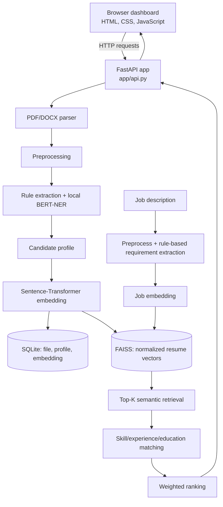

# TalentLens — AI Resume Analyzer & Candidate Ranking System

A locally runnable candidate-screening application. Recruiters upload PDF or DOCX resumes, provide a job description, and review candidates retrieved and ranked by the implemented NLP pipeline in a browser dashboard.

> **Project status:** college/demo prototype, not a production hiring system. Scores are heuristic matching signals, not hiring probabilities. Human review is required.

## What it does

- Supports recruiter account creation, sign-in, and sign-out. Resume records and FAISS indexes are isolated by account.
- Accepts multiple PDF and DOCX resumes, with per-file error reporting.
- Extracts selectable PDF text with PyMuPDF and DOCX paragraphs/tables with `python-docx`.
- Normalizes extracted text and creates candidate profiles containing skills, education, roles, experience, companies, projects, and certifications using configurable rules plus an optional local BERT-NER checkpoint.
- Generates one normalized Sentence-Transformer embedding per candidate profile and one per job description.
- Retrieves semantically similar candidate profiles using a per-user FAISS index.
- Calculates skill, basic experience, and basic education matches, then ranks retrieved candidates.
- Stores recruiter accounts, original resume bytes (in local mode), candidate profiles, and embeddings in SQLite.
- Supports optional S3 storage for original resumes; local SQLite storage remains the default.
- Includes 10 synthetic demo resumes and three sample job descriptions. Demo rankings are calculated by the same pipeline as uploaded resumes.

## Architecture and request flow



### Resume processing

1. The dashboard sends selected files to `POST /api/process`; the demo button calls `POST /api/demo`.
2. The API validates file extension and size, then `document_parser.py` extracts text.
3. `information_extractor.py` preprocesses the text, finds sections, applies the technology/role/experience rules, and merges entities predicted by the local BERT-NER checkpoint when available.
4. The candidate profile is converted into embedding text and encoded by `all-MiniLM-L6-v2`.
5. SQLite stores the structured profile and embedding. Original files stay in SQLite in local mode, or are sent to S3 in optional S3 mode. The normalized vector is also added to that user's FAISS index; the mapping file connects FAISS positions to candidate IDs.

### Job analysis and ranking

1. The dashboard sends the job title, job description, and requested top-K value to `POST /api/analyze`.
2. The description is preprocessed and embedded with the same Sentence-Transformer used for resumes. The job title is returned for display; the description drives the current embedding and matching process.
3. FAISS performs cosine-similarity retrieval using normalized vectors and `IndexFlatIP`.
4. For retrieved candidates, the matching service compares skills and applies simple experience and education heuristics. The JD currently uses rule/dictionary extraction for these requirements; it is **not** passed through the resume BERT-NER service.
5. The ranking service sorts candidates by the weighted score and returns results to the browser as JSON.

## Technology stack

- **API/server:** Python, FastAPI, Uvicorn
- **Browser UI:** HTML, CSS, vanilla JavaScript
- **Document extraction:** PyMuPDF, python-docx
- **Resume entity extraction:** configurable rule-based extraction and locally fine-tuned BERT token classifier (Transformers/PyTorch)
- **Embeddings:** Sentence-Transformers, `sentence-transformers/all-MiniLM-L6-v2`
- **Vector search:** FAISS `IndexFlatIP` with L2-normalized vectors (cosine similarity)
- **Persistent local storage:** SQLite
- **Optional object storage:** AWS S3 via boto3 (opt-in; local mode remains the default)
- **Testing:** pytest

## Repository structure

```text
resume-analyzer/
├── app/
│   ├── api.py                    # FastAPI entry point, auth, routes, pipeline orchestration
│   ├── config.py                 # Runtime paths and embedding model name
│   ├── storage.py                # SQLite schema and persistence operations
│   ├── services/
│   │   ├── document_parser.py    # PDF/DOCX text extraction
│   │   ├── preprocessing.py      # Text normalization and section detection
│   │   ├── information_extractor.py # Candidate profile, rules, and NER integration
│   │   ├── ner_service.py        # Local fine-tuned BERT-NER loading and inference
│   │   ├── file_storage.py       # Optional S3 resume-object storage
│   │   ├── embedding_service.py  # Cached Sentence-Transformer embeddings
│   │   ├── faiss_service.py      # FAISS index build, save/load, and search
│   │   ├── matching_service.py   # Skill, experience, and education signals
│   │   └── ranking_service.py    # Final score and descending ranking
│   ├── static/
│   │   ├── index.html            # Login and dashboard structure
│   │   ├── app.js                # API calls, upload flow, and result rendering
│   │   └── styles.css             # Responsive styling
│   └── utils/                    # Shared text and file helpers
├── data/
│   ├── resumes/                  # Placeholder; local uploads are in SQLite or S3
│   ├── processed/                # Reserved local processing directory
│   └── ner_*/                    # Local NER training datasets, when present
├── models/                       # Local NER checkpoints, when present
├── artifacts/                    # Local NER metrics and reports, when present
├── vector_store/users/<id>/      # Runtime FAISS index and candidate mapping
├── sample_data/
│   ├── resumes/                  # 10 synthetic demo resumes
│   └── job_descriptions/         # Three demo job descriptions
├── tools/
│   ├── generate_demo_data.py
│   ├── generate_synthetic_ner.py
│   └── train_ner.py
├── tests/
├── deploy/aws/                   # EC2 + S3 setup guidance
├── requirements.txt
└── README.md
```

## Local data and storage

| Data | Location | Purpose |
|---|---|---|
| SQLite database | `data/talentlens.sqlite3` | Accounts, profiles, embeddings, and resume-storage metadata; local mode also stores original bytes |
| Session signing secret | `data/.session_secret` | Signs local session cookies; generated on first server start |
| FAISS index | `vector_store/users/<user_id>/resume.index` | Fast semantic search over that user's resume embeddings |
| FAISS mapping | `vector_store/users/<user_id>/mapping.json` | Maps FAISS row numbers to candidate IDs |
| NER checkpoint | `models/resume_ner_synthetic_3000/best/` | Token-classification model and tokenizer used by resume extraction |
| SBERT cache | `model_cache/` | Locally cached Sentence-Transformer files after first download |

SQLite is the durable source of truth for accounts, profiles, and embeddings. If the FAISS index is missing or does not match the stored candidate IDs, the API can rebuild it from embeddings in SQLite. In default local mode, uploaded documents are stored as SQLite BLOBs, not as separate files under `data/resumes`.

The NER training corpora, fine-tuned checkpoint, and evaluation artifacts are local machine-learning assets. The application does not download the fine-tuned checkpoint automatically. If a checkpoint is available in one of the paths described below, the API loads it locally; if none is present or inference fails, candidate extraction falls back to the rule-based pipeline. These assets are not required to start the application. Sentence-Transformers loads SBERT and downloads it to the local cache on first use when needed.

## Optional AWS deployment (EC2 + S3)

The API can store newly uploaded originals in a private S3 bucket while SQLite
continues to hold accounts, profiles, embeddings, and S3 object references.
Set `RESUME_STORAGE_BACKEND=s3`, `S3_BUCKET`, and `AWS_REGION` to enable it;
leave the backend unset or set it to `sqlite` for the current local behavior.
On EC2, use a narrowly scoped instance role instead of long-lived AWS keys.

EC2 is the application host; S3 is only the original-document object store.
SQLite and FAISS remain on one EC2 EBS volume in this prototype, so this setup
is single-instance and should not be scaled horizontally. Deployment and
security steps are documented in [`deploy/aws/README.md`](deploy/aws/README.md).
No AWS resources are created automatically by the application.

### Runtime configuration

Local SQLite storage is the default and needs no AWS configuration. To select
S3 storage, create a `.env` file from `.env.example` and set:

```env
RESUME_STORAGE_BACKEND=s3
S3_BUCKET=your-private-bucket-name
S3_RESUME_PREFIX=resumes
AWS_REGION=your-aws-region
```

The application uses the standard boto3 credential lookup. For EC2, attach an
IAM instance role with access limited to the resume bucket and prefix. The
embedding model is currently fixed in `app/config.py`; the `MODEL_NAME` sample
in `.env.example` is not read as an override.

## Installation

Python 3.10 or newer is recommended. From the repository root:

### Windows PowerShell

```powershell
py -3.11 -m venv .venv
.\.venv\Scripts\Activate.ps1
python -m pip install --upgrade pip
python -m pip install -r requirements.txt
```

### macOS/Linux

```bash
python3 -m venv .venv
source .venv/bin/activate
python -m pip install --upgrade pip
python -m pip install -r requirements.txt
```

The first resume-processing request may download `all-MiniLM-L6-v2` from Hugging Face into the local cache. Internet access is needed for that initial download unless the model is already cached.

### Optional GPU training

The fine-tuning script uses CUDA when the installed PyTorch build can see a CUDA-compatible GPU. For a GPU-required run, pass `--require-cuda`; the trainer will stop instead of silently falling back to CPU. Install a PyTorch build compatible with your driver and verify `torch.cuda.is_available()` before training. CPU can be used for inference and may be used for training if the GPU-required flag is omitted, but training will take longer.

## Run the application

From the project root, with the environment activated:

```bash
python -m uvicorn app.api:app --host 127.0.0.1 --port 8000
```

Then open [http://127.0.0.1:8000](http://127.0.0.1:8000). Keep the terminal running while you use the dashboard.

### First-run and demo workflow

1. Create a recruiter account from the sign-in screen, or sign in with an existing account. Additional accounts can also be registered.
2. Select **Load demo candidates** to process the included synthetic resumes, or upload your own PDF/DOCX resumes.
3. For uploads, choose up to 25 resumes per processing batch. The per-file limit is 10 MB and the combined batch limit is 100 MB. If more files are queued, process the next batch after the current one finishes.
4. Enter a job title and job description. You can use a sample file under `sample_data/job_descriptions/`.
5. Choose K and click **Find top candidates**.
6. Review the ranking, score components, matched/missing skills, and extracted candidate details.

The demo resumes and job descriptions are synthetic fixtures for demonstrating the workflow; their results are produced by the implemented processing pipeline, not hardcoded rankings.

## Ranking formula

```text
Job Match Score =
    0.50 × semantic similarity
  + 0.30 × skill match
  + 0.10 × experience match
  + 0.10 × education match
```

Each component is bounded between 0 and 1. Skill match is the fraction of distinct required JD skills found in the candidate profile. The experience and education components are simple heuristics. The semantic score is the FAISS retrieval similarity. The final score is a prototype ranking signal—not a hiring probability, guarantee of qualification, or scientifically calibrated decision.

## Current fine-tuned NER model

The API searches for `models/resume_ner_synthetic_3000/best/` first, then local 2,000-example, 1,000-example, and original checkpoints. The model is loaded lazily and reused within the server process. It is a BERT-based token-classification model fine-tuned from `BAAI/bge-small-en-v1.5` with 15 BIO labels: `O` plus begin/inside tags for skills, education, companies, job roles, experience, projects, and certifications. Rules remain active alongside NER, including the configurable technical-skill dictionary. The job description is not passed through resume NER; JD skills are extracted with the rule dictionary used by matching.

### Training data and tuning

- Training: 207 human-annotated resumes plus 3,000 synthetic training resumes = **3,207 documents** and **3,534 chunks**.
- Validation: 44 human-annotated resumes; used for tuning and checkpoint selection.
- Test: 45 human-annotated resumes; evaluated after choosing the configuration.
- Hyperparameter sweep: learning rates `5e-6` and `1e-5`; batch sizes 8 and 16; two epochs per trial.
- Selected settings: learning rate `1e-5`, batch size 8, weight decay `0.01`, seed 42, max length 512, best epoch 2.
- Training hardware for the saved checkpoint: NVIDIA GeForce RTX 4050 Laptop GPU.

Final reported test metrics use exact entity-span matching:

| Metric | Score |
|---|---:|
| Precision | 0.2949 |
| Recall | 0.5143 |
| Exact-span F1 | 0.3748 |

Skill F1 was 0.4334, job-role F1 0.4170, experience F1 0.3453, company F1 0.2698, and education F1 0.1997. The test set contained no positive project or certification examples, so those labels could not be meaningfully evaluated. Achievements are not a current NER label.

**Evaluation caveat:** this small test split also appeared in earlier development reports. The current hyperparameter sweep selected settings using validation data, but the test set is not an independent benchmark. Treat these scores as internal prototype measurements, not evidence of production-level accuracy.

The tuning report and machine-readable metrics were generated under `artifacts/`
on the training machine. These local reports and model files are not required
to run the application and may not be present in a fresh GitHub clone.

### Reproduce the latest fine-tuning stage

This command reproduces the recorded 3,000-example synthetic fine-tuning stage.
The human dataset, three synthetic training batches, prior 2,000-example
checkpoint, and output directories must exist locally; these training assets
are not downloaded automatically and may not be included in a fresh clone.

```bash
python tools/train_ner.py \
  --require-cuda \
  --dataset-dir data/ner_train_dataset \
  --synthetic-train data/ner_synthetic_1000/train.jsonl \
  --synthetic-train data/ner_synthetic_1000_batch2/train.jsonl \
  --synthetic-train data/ner_synthetic_1000_resume_informed/train.jsonl \
  --base-model models/resume_ner_synthetic_2000/best \
  --epochs 2 \
  --batch-size 8 \
  --learning-rate 1e-5 \
  --weight-decay 0.01 \
  --max-length 512 \
  --seed 42 \
  --output-dir models/resume_ner_synthetic_3000 \
  --metrics-output artifacts/ner_metrics_synthetic_3000.json \
  --predictions-output artifacts/ner_test_predictions_synthetic_3000.json
```

For hyperparameter trials, use `--validation-only` so trials do not evaluate the test split. Select settings from validation metrics, then run a final training/evaluation separately.

## Tests

Run the full test suite from the repository root:

```bash
python -m pytest -q
```

The tests cover parsing, preprocessing, information extraction, embeddings, FAISS, matching, ranking, authentication, resume-file access, S3 storage behavior, and NER training utilities. Embedding tests may download or load the Sentence-Transformer model on first execution.

## Runtime behavior and privacy

- This is a local prototype, not a production recruitment platform or an automated decision system.
- NER training data includes synthetic examples. Synthetic augmentation does not prove real-resume generalization.
- The labeled dataset and test set are small. Projects and certifications lack positive test examples; achievements are not modeled.
- JD requirement extraction is rule-based. Experience and education matching are intentionally basic.
- PDF parsing extracts selectable text; image-only/scanned PDFs without a text layer are rejected as unreadable.
- Local resume files and database records are not encrypted at rest. Passwords are stored as salted PBKDF2-SHA256 hashes and the session cookie is HTTP-only, SameSite=Strict, and valid for 12 hours, but this is not production-grade account/security administration.
- Do not expose this development server to a network or use it for real hiring decisions without security, privacy, data-retention, evaluation, and human-review controls.
- The local SQLite database, `.session_secret`, raw resumes, and model cache contain private or runtime data. Fine-tuned model weights can be large. The NER checkpoint and training files are local assets, not application dependencies that are downloaded automatically.
